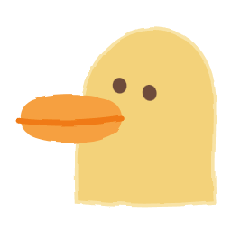
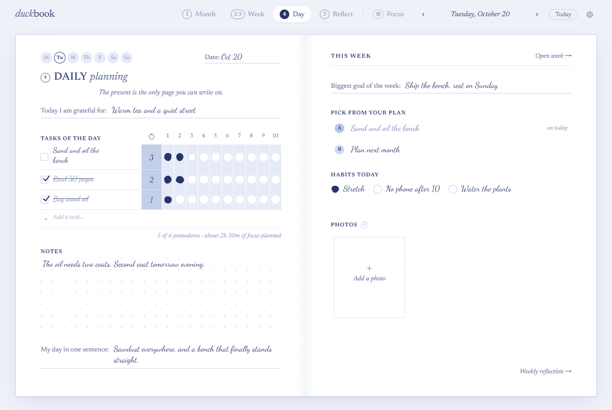
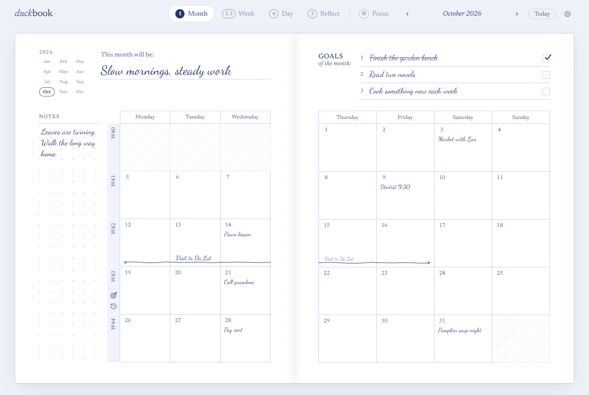
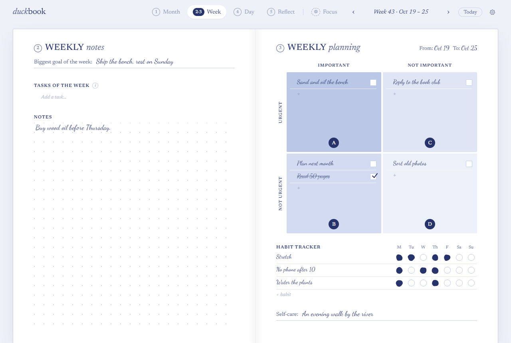
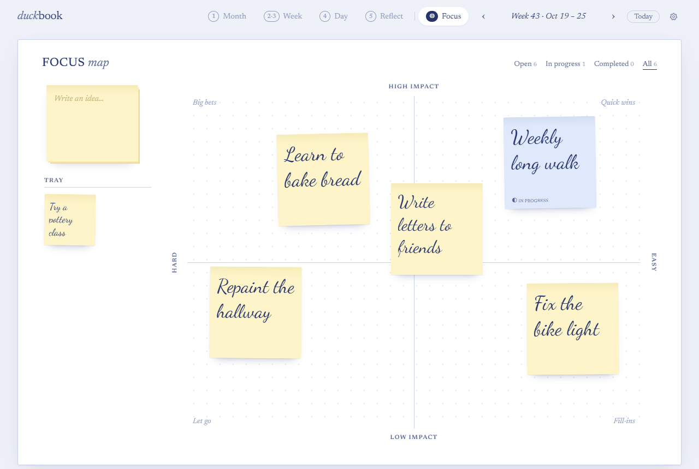

# Duckbook

[](https://github.com/Thander-cute/duckbook/actions/workflows/ci.yml)
[](https://github.com/Thander-cute/duckbook/releases/latest)
[](LICENSE)

A quiet, paper-style planner for Windows and your browser, after *The Present Day Planner*.
Month, week and day pages in pale-blue ink, a weekly look back, and an optional focus map, kept on your own computer.

[Download for Windows](https://github.com/Thander-cute/duckbook/releases/latest) · [Privacy](docs/DATA-AND-PRIVACY.md) · [Changelog](CHANGELOG.md)



> Duckbook is in beta. Keep your own copy of your data folder.

## Features

- **Month:** a theme, goals, a calendar with notes per day and notes that span several days.
- **Week:** tasks of the week on an urgent/important grid, and a habit tracker.
- **Day:** tasks with pomodoro estimates, gratitude, your day in one sentence, up to three photos, and a focus timer.
- **Reflect:** the week in seven sentences, and a look back on the month.
- **Focus Map** (optional): sticky-note ideas on an impact × difficulty map, planned into weeks.
- **Yours, on your computer:** pages in a local SQLite database with automatic verified backups, an optional PIN lock, and JSON export and import.
- **Optional Google Drive sync** between your computers, into a folder in your own Drive. No Duckbook account or server.

No analytics, no ads, no AI. See [docs/GUIDE.md](docs/GUIDE.md) for how the pages work.

| Month | Week | Focus Map |
| --- | --- | --- |
|  |  |  |

<sub>Screenshots use made-up pages (`npm run screenshots`).</sub>

## Install

### Windows app

1. Download `Duckbook-Setup-<version>.exe` from [Releases](https://github.com/Thander-cute/duckbook/releases/latest).
2. Run it. The installer is per-user and **not code-signed**, so Windows SmartScreen warns: choose *More info → Run anyway* if you trust this repository.

Duckbook checks for a new version when it opens and when you press *Check now* in **Settings → Data → App updates**. You choose when to download and when to install. *Install and restart* saves every page first, and won't install if anything is unsaved. Versions before 0.1.0-beta.3 can't update themselves: install a newer version by hand once.

### Browser version (from source)

Requires [Node.js](https://nodejs.org/) 24 or later, on Windows.

1. Clone this repository and double-click **`Duckbook.cmd`**. The first launch installs and builds, then opens `http://localhost:5317`.
2. `Duckbook.cmd --shortcut` puts a shortcut on the desktop; `Duckbook.cmd --stop` stops the background server.
3. After pulling a new version, let open tabs finish saving, run `Duckbook.cmd` again and accept the server restart, then reload the tab.

The Windows app and the browser version each keep their own notebook. The app can copy in the browser version's pages (Settings → Data), or both can sync through the same Google Drive.

## Your data

Your pages, photos and backups stay in a folder on your computer; [docs/DATA-AND-PRIVACY.md](docs/DATA-AND-PRIVACY.md) says exactly where, and what leaves your computer:

- **Google Drive sync**, only if you turn it on. Synced files are **not encrypted**: anyone with access to that Google account can read them.
- **Update checks** to GitHub from the Windows app. Nothing about your notebook is sent.

The PIN is an access lock, not encryption. Backups sit on the same disk as your notebook, so copy the data folder elsewhere now and then.

## Develop

```bash
npm install
npm run typecheck
npm test                 # server, storage, PIN and crash-safety tests
npm run build
npm run test:browser     # browser checks on a throwaway server with synthetic data
npm run desktop:build    # Windows installer in release/
```

Run a development server on a spare port with a temporary data folder, never against your own notebook:

```bash
npm run build
DUCKBOOK_PORT=5398 DUCKBOOK_DATA_DIR=/tmp/duckbook-dev node server/main.ts
```

Desktop development (`npm run desktop:dev`) likewise needs `DUCKBOOK_DESKTOP_DATA_DIR`, `DUCKBOOK_WEB_DATA_DIR`, `DUCKBOOK_WEB_PORT` and `DUCKBOOK_DESKTOP_PORT`. Builds from source have no Google Drive sync unless you add your own OAuth client ([docs/GOOGLE-DRIVE-SYNC-SETUP.md](docs/GOOGLE-DRIVE-SYNC-SETUP.md)).

## Contributing

Issues and pull requests are welcome. Start with [CONTRIBUTING.md](CONTRIBUTING.md); please follow the [code of conduct](CODE_OF_CONDUCT.md), and report security problems privately as described in [SECURITY.md](SECURITY.md). Maintainers release with [docs/RELEASING.md](docs/RELEASING.md); coding agents read [AGENTS.md](AGENTS.md).

## Licence

[PolyForm Noncommercial 1.0.0](LICENSE): you may use, change and share Duckbook for any noncommercial purpose, but not sell it or use it commercially (the licence text has the exact terms). Duckbook's source is public, but this is not an OSI open-source licence. Releases up to and including 0.1.0-beta.3, and the source published here before the licence change, were under the MIT licence; copies obtained under it keep that licence ([LICENSE-MIT-PRIOR.txt](LICENSE-MIT-PRIOR.txt)).

The Windows app ships `THIRD_PARTY_NOTICES.txt` with the licences of the libraries and fonts it includes.

Duckbook is an independent project, inspired by *The Present Day Planner* by The Present Writer. It is not affiliated with or endorsed by them, or by Google.
